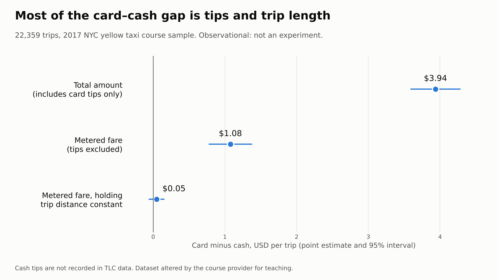

# Do card payers pay higher taxi fares? Separating tips and trip length

**Course exercise, revised.** Self-initiated re-analysis of a course project. The business scenario is fictitious and the course provider altered the data for teaching. This is not client work. Revised with AI assistance; the figures come from the scripts in this folder.

## Question
Do trips paid by card carry higher amounts than trips paid in cash, and what explains any gap?

## Data
2017 NYC yellow taxi course sample, 22,699 trips (22,532 paid by card or cash). The [TLC data dictionary](https://www.nyc.gov/assets/tlc/downloads/pdf/data_dictionary_trip_records_yellow.pdf) states that tips are recorded for card payments only and that `total_amount` excludes cash tips.

## Method
- Removed 173 trips with fare <= 0 or > 200 USD, distance <= 0, or duration <= 0 or > 180 minutes. Unfiltered results are reported too.
- Welch two-sample comparisons with 95% intervals and standardised effect size.
- OLS with HC3 robust errors, adding trip distance, then duration and rate code.

## Results (card minus cash, USD per trip, filtered data)
| Comparison | Difference | 95% interval |
|---|---|---|
| Total amount | 3.94 | 3.59 to 4.28 |
| Metered fare | 1.08 | 0.78 to 1.37 |
| Metered fare, holding distance constant | 0.05 | -0.06 to 0.15 |
| Plus duration and rate code | 0.05 | -0.02 to 0.12 |



Recorded tips account for 2.70 of the 3.94 total-amount gap (69%). Card trips are also longer on average (3.04 vs 2.67 miles). Once distance is held constant, there is no clear fare difference.

## Business reading
This data gives no support for promoting card payment as a way to raise fare revenue. Testing whether payment method changes behaviour would need a designed experiment and a measure of tips that covers both payment types.

## Limitations
Observational data; payment method was chosen, not assigned. Cash tips are unobserved. Altered teaching sample, so results should not be generalised to NYC. Filter thresholds are analyst choices.

## Reproduce
Open `tlc_payment_type_analysis.ipynb` (keep the CSV in the same folder), or run:
```
pip install -r requirements.txt
python analysis.py 2017_Yellow_Taxi_Trip_Data.csv
python chart.py 2017_Yellow_Taxi_Trip_Data.csv
```

## Revision note
The July 2023 version described a randomised experiment that did not take place, compared `total_amount` (which includes card tips only), recommended encouraging card payment, and stated both that the null was rejected and that there was no significant difference. This version replaces it.
